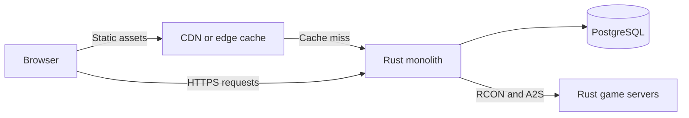

# Cupboard architecture

## Status

This document records the architecture decisions made before application code is
added. The runtime stack is only partly selected. The remaining decisions at the
end of this document must be resolved before the first application slice begins.

## Product boundary

Cupboard is one deployable application for Rust server operators. It owns the web
interface, authentication, tenant-scoped data, PostgreSQL persistence, RCON and
A2S communication, and scheduled server-health checks.

The application remains a monolith until a measured reliability, performance, or
ownership problem requires a process or service boundary. Product feature names
do not create service boundaries.

## Production shape

The Rust monolith is the only production application process. It contains the
HTTP server, application behavior, background work, and external server
integrations. Modules call each other directly. Cupboard does not use internal
HTTP, a message bus, Redis, or a separate worker at launch.

PostgreSQL is the only application data store. Once a migration has been used
outside local development, later changes use forward-only migrations.

## Frontend

The frontend uses React and TypeScript, built with Vite. React Router runs in SPA
mode with runtime server rendering disabled.

The frontend build produces static HTML, JavaScript, CSS, and other assets. Node.js
is a development and build dependency only. Production does not run Next.js, a
Node.js frontend server, React Server Components, or frontend middleware.

The production build packages the static assets with the application artifact.
A CDN or edge proxy should cache those assets. Content-hashed assets receive a
long immutable cache lifetime, while the application shell uses a short or
revalidation-based policy so deployments become visible promptly. This cache is
delivery infrastructure, not another application service.

The browser fetches runtime data from the Rust monolith. The frontend never
connects to PostgreSQL, RCON, or A2S directly. The Rust application enforces all
authentication, authorization, workflow, and tenant rules.

## HTTP interfaces

The monolith has two HTTP contract boundaries backed by the same application
behavior:

- `/app-api/*` supports the Cupboard web interface. It uses an authenticated web
  session and may evolve with the frontend.
- `/api/v1/*` will be the supported public API when that work enters the launch
  scope. It is versioned and uses scoped API credentials, rate limits, and
  pagination where applicable.

The public API gives operators a supported way to automate Cupboard. The browser
interface may use application-specific responses without turning those responses
into a compatibility promise. Both interfaces call the same Rust functions for
authorization, tenant-scoped access, validation, and persistence. Business rules
must not be copied into route handlers.

Cupboard does not treat application API routes as secret or assume they can only
be called by the shipped frontend. Every request must be safe when called
directly, repeated, or sent out of the expected UI order.

## Server health and load

Page views and public API requests do not start RCON or A2S checks. Background
work in the monolith checks each configured Rust server on its own schedule and
stores the latest useful snapshot. The dashboard and public API read that
snapshot, so adding viewers does not multiply traffic to managed game servers.

The first dashboard may poll snapshots every 15 to 30 seconds while its page is
visible. It should stop polling when hidden and back off after failures. A later
move to server-sent events or another live-update mechanism requires measured
evidence that polling no longer meets the product or load requirement.

Authenticated tenant data must not enter a shared cache. Read endpoints may use
private browser caching, conditional requests, or short-lived in-process caching
when their authorization and invalidation behavior is explicit.

## Security properties

- Every data access is scoped to the authenticated tenant in the Rust data-access
  path.
- Route handlers do not accept a tenant identifier as proof of ownership.
- RCON passwords, session tokens, API credentials, and other raw secrets never
  appear in logs or frontend responses.
- Stored server credentials are encrypted with a maintained cryptography library;
  the key source will be selected with the deployment target.
- Public API credentials have explicit scopes, can be revoked, and are stored in a
  non-recoverable form when Cupboard does not need to display them again.
- Tests cover tenant isolation, authorization, secret handling, and the main
  success path of every user-visible slice.

## Development and delivery

A fresh clone will provide one root command that starts PostgreSQL, the Rust
application, and the Vite development server. A separate root command will run all
required formatting, static checks, and tests for Rust and TypeScript.

Development tooling may run several child processes behind that one command.
Production still deploys one application artifact. The build compiles the static
frontend before assembling that artifact.

## Deliberately absent

The starting architecture does not include microservices, a separate frontend
runtime, server-side frontend rendering, an internal API service, Redis, a queue,
or a standalone worker. Any later addition must name the current measured problem
that requires it in `docs/REBUILD.md`.

## Decisions still required before code

The following choices remain open and must be made as one compatible set:

- Rust web framework and asynchronous runtime
- PostgreSQL access and migration library
- Authentication and session provider
- Production deployment target and secret-key source
- CDN or edge-cache implementation

These decisions should favor maintained libraries, fast automated tests, one-step
local development, and a deployment that does not introduce services without a
current need.
