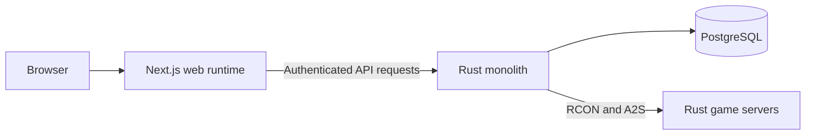

# Cupboard architecture

## Status

This document records the starting architecture. The frontend and Rust runtime foundations are implemented. Accounts, sessions, organization membership, and role management now use the
Rust API and PostgreSQL. Server connections remain the next product work.

## Product boundary

Cupboard has a Next.js web runtime and a Rust application runtime for server
operators. The web runtime owns rendering and browser-facing interaction. The
Rust application owns authentication enforcement, tenant-scoped data,
PostgreSQL persistence, RCON and A2S communication, and scheduled server-health
checks.

The Rust application remains a monolith until a measured reliability,
performance, or ownership problem requires another process or service boundary.
Product feature names do not create service boundaries.

## Production shape

The Next.js process is the server-rendered web boundary. The Rust monolith
contains application behavior, background work, persistence, authorization, and
external server integrations. Modules inside the Rust application call each
other directly. Cupboard does not use a message bus, Redis, or a separate worker
at launch.

PostgreSQL is the only application data store. Once a migration has been used
outside local development, later changes use forward-only migrations.

## Web frontend

The frontend uses React, TypeScript, and the Next.js App Router. Pages and layouts
are Server Components by default. They may fetch from the Rust API during server
rendering. Client Components are reserved for browser state, event handlers, and
live interactions. Frequently refreshed server state may use TanStack Query when
the first feature needs client caching or polling.

Tailwind CSS provides utility styles and semantic Slate theme variables. Shadcn
is initialized with Radix and its current component catalog is source-owned in
`src/components/ui`. Cupboard-specific components will live with their feature
or in `src/components/app`. The UI does not use a separately published component
package because only one application consumes it.

The operator experience is AI first. The primary interface accepts an operator's
intent, shows which server data the assistant used, separates findings from
proposed actions, and reports a verified result after execution. Conventional
screens will remain available for inspection and direct control. Any action that can
interrupt service, change configuration, expose data, or affect players requires
an explicit approval step. The backend will enforce authorization and approval;
the frontend is never the enforcement boundary.

The production build creates a Next.js server artifact plus browser assets. A CDN
or edge proxy may cache content-hashed assets. Server-rendered routes remain
dynamic when they depend on operator sessions or tenant data.

The Next.js runtime calls the Rust application over HTTP. It never connects to
PostgreSQL, RCON, or A2S directly. The Rust application enforces all
authentication, authorization, workflow, and tenant rules. Rendering a control
in Next.js is never proof that an operator may perform its action.

## HTTP interfaces

The system has two HTTP contract boundaries backed by the same Rust application
behavior:

- `/app-api/*` supports the Next.js web runtime. It uses an authenticated web
  session and may evolve with the frontend. Server Components call it directly;
  browser-side requests use a same-origin Next.js boundary when required.
- `/api/v1/*` will be the supported public API when that work enters the launch
  scope. It is versioned and uses scoped API credentials, rate limits, and
  pagination where applicable.

The public API gives operators a supported way to automate Cupboard. The browser
interface may use application-specific responses without turning those responses
into a compatibility promise. Both interfaces call the same Rust functions for
authorization, tenant-scoped access, validation, and persistence. Business rules
must not be copied into route handlers.

Cupboard does not treat application API routes as secret or assume that only the
Next.js runtime can call them. Every request must be safe when called directly,
repeated, or sent out of the expected UI order.

## Server health and load

Page views and public API requests do not start RCON or A2S checks. Background
work in the monolith checks each configured Rust server on its own schedule and
stores the latest useful snapshot. The dashboard and public API read that
snapshot, so adding viewers does not multiply traffic to managed game servers.

The first dashboard may poll snapshots every 15 to 30 seconds while its page is
visible. It should stop polling when hidden and back off after failures. A later
move to server-sent events or another live-update mechanism requires measured
evidence that polling no longer meets the product or load requirement.

Authenticated tenant data must not enter a shared cache. Read endpoints may use
private browser caching, conditional requests, or short-lived in-process caching
when their authorization and invalidation behavior is explicit.

## Security properties

- Every data access is scoped to the authenticated tenant in the Rust data-access
  path.
- Route handlers do not accept a tenant identifier as proof of ownership.
- RCON passwords, session tokens, API credentials, and other raw secrets never
  appear in logs or frontend responses.
- Stored server credentials are encrypted with a maintained cryptography library;
  the key source will be selected with the deployment target.
- Public API credentials have explicit scopes, can be revoked, and are stored in a
  non-recoverable form when Cupboard does not need to display them again.
- Tests cover tenant isolation, authorization, secret handling, and the main
  success path of every user-visible slice.

## Development and delivery

A fresh clone will provide one root command that starts PostgreSQL, the Rust
application, and the Next.js development server. A separate root command will
run all required formatting, static checks, and tests for Rust and TypeScript.

Development tooling may run several child processes behind that one command.
Production deploys the Next.js web artifact and the Rust application artifact.

`npm run dev` starts local PostgreSQL, builds and runs the Rust API, and starts
Next.js with hot reloading on `0.0.0.0`. It prints the active NetBird URL. Rust
changes currently require restarting this command. `npm run check` runs Rust
formatting, Clippy, database integration tests, web checks, and the production web
build. Its disposable PostgreSQL instance is separate from development data.

## Selected backend stack and deployment

- Axum and Tokio run one Rust application, with source in `backend/` and a root
  Cargo package. SQLx provides PostgreSQL pooling and embedded migrations.
- Cupboard owns operator accounts and sessions, with no external identity
  provider. `axum-login` 0.18 and `tower-sessions` 0.14 handle authentication
  sessions; their official PostgreSQL store requires SQLx 0.8. Argon2id hashes
  passwords. Session cookies are HttpOnly, SameSite=Lax, Secure in production,
  and expire after 12 hours. Logout revokes the stored session.
- Every team read checks active tenant membership and `organization.manage` in
  the data-access path. Team writes lock the organization row, recheck permissions,
  and compare a revision before modifying data. Tenant IDs never prove ownership.
  PostgreSQL enforces composite tenant/role references and unique memberships.
  Memberships have multiple role assignments; permissions combine, while the
  highest ranked role bounds management of lower roles and users. Organization
  ownership is recorded separately and its Owner role is exclusive. Owner and
  Administrator have full permissions and fixed top positions. Custom role order
  is persisted and checked on every mutation.
- Signup creates only an account and session. Accounts can have zero organization
  memberships. Explicit organization creation creates the organization, two
  built-in roles (Owner and Administrator), and the creator’s Owner membership in one transaction. Joining
  an invitation does not create another organization. Invitations are seven-day,
  single-use bearer links whose
  random tokens are hashed at rest. Acceptance requires the matching account
  email. Email delivery and verification remain separate work.
- Production runs in the existing USE1 Kubernetes cluster. Argo CD reconciles
  deployment manifests from `Vanguard-Enterprise/v-deployments`.
- Production PostgreSQL runs in that cluster. Local development uses PostgreSQL
  18 in Docker Compose with a named volume.
- GitHub Actions uses GitHub-hosted `ubuntu-24.04` VMs with Docker and Compose.
  The workflow installs the pinned Rust and Node.js versions and runs the root
  checks directly on the VM. Fork pull requests remain excluded by the workflow.
- `backend/Dockerfile` builds the Rust artifact and runs it as a non-root user.
  `DATABASE_URL` comes from the deployment environment. Credentials are never
  baked into the image. Kubernetes should probe `/health/live` for liveness and
  `/health/ready` for database readiness, both on port 8080.
- Deployment-specific secret references, ingress, image publishing, and release
  promotion will be configured with the first deployment in `v-deployments`.
  The cluster already has OpenBao and External Secrets configuration; Cupboard's
  secret bindings still need to be defined there.
- A separate CDN is not required for the first deployment.

The runtime exposes health checks and application API routes for signup, login,
logout, the current identity, organization switching, team management, and
invitation acceptance. Next.js renders the workspace only after fetching the
current identity from Rust. Browser mutations use a same-origin Next.js proxy;
Rust independently checks allowed origins and the custom request header.

The first application migration contains accounts, organizations, tenant roles,
memberships, invitation hashes, authentication throttle buckets, and the schema
required by the session store. SQLx embeds migrations and applies them under its
migration lock at startup. No account or authorization state falls back to local
browser storage. Other settings previews use browser storage namespaced by
account and active organization; they are not shared backend records. A keyed
React provider remounts those previews when either identity changes, discarding
unsaved drafts and cached values. Reads, writes, cross-tab subscriptions, conflict
checks, and clearing data use the same namespace. Legacy unscoped records are
ignored because their tenant ownership cannot be determined. This prevents
accidental reuse between workspaces; browser storage remains readable by anyone
with access to that browser profile.
